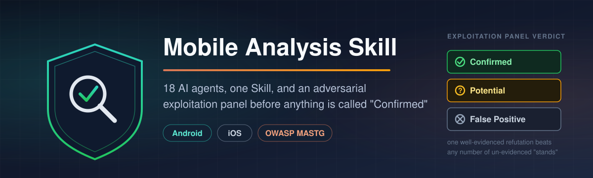

<p align="center">
  
</p>

# Mobile Analysis Skill

**An agent-driven harness for Android & iOS mobile application security audits, OWASP MASVS/MASTG-aligned, with a deterministic orchestrator and adversarial exploitation confirmation. Runs on Claude Code and opencode.**

<p align="center">
  
  
  
  
  
  
</p>

A complete mobile application security assessment toolkit: one orchestrating **Skill**, **18 specialist subagents**, a **deterministic orchestrator**, a **taint pre-pass** (Semgrep + FlowDroid + Hermes), and an **adversarial exploitation panel**. A prosecutor agent and independent skeptic agents have to actually try to break each other's case before anything is allowed to be reported as **Confirmed**. It runs unchanged in Claude Code and in opencode: the skill is a plain `SKILL.md`, and the repo ships the 18 agents in both harnesses' formats.

It covers Android and iOS manifest/plist/entitlements, local storage and cryptography, taint analysis (source → sink → sanitizer), WebView/OAuth/OIDC/deep-links/clipboard, Android IPC and UI-layer attacks, iOS platform attacks, anti-tamper/resilience (root/jailbreak/pinning/debugger/Frida detection), network and backend API weaknesses, supply-chain and cross-platform-framework issues (Flutter, React Native, Xamarin, Unity, Cordova, KMP), and business-logic abuse.

> **This is a dual-use security tool. Read [Authorization & Legal](#authorization--legal) before running it against anything.**

**Jump to:** [Installation](#installation) · [Recommended tools](#recommended-tools-put-these-on-path) · [Why the adversarial panel](#why-the-adversarial-panel) · [Architecture](#architecture) · [Agent roster](#agent-roster) · [Usage](#usage) · [FAQ](#faq) · [Authorization & Legal](#authorization--legal) · [Credits](#credits)

## What this fork changes

This is a hardened, restructured fork of [`harshdhamaniya/mobile-security-skill`](https://github.com/harshdhamaniya/mobile-security-skill). The original design (skill + 18 specialists + prosecutor/skeptic panel) is kept; the parts that used to live in the orchestrating model's memory are now **deterministic code**, and analysis got two new deterministic front-ends:

- **`scripts/orchestrate.py`** — a state machine + CLI for the pipeline: `status`, `dedup`, `under-review`, `next`, `claim`, `decide`, `consolidate`, `validate`. It encodes the `severity-rating.md` decision rule in code, so the model no longer has to remember it.
- **Structured panel verdicts** — the prosecutor writes `<id>.prosecutor.json`, each skeptic writes `<id>.skeptic-<label>.json`, and `orchestrate.py decide` aggregates them by *evidence primacy* (any single well-evidenced `refuted` wins, regardless of vote count).
- **Atomic finding-ID allocation** — `orchestrate.py claim` reserves `<PLATFORM>-<DOMAIN>-<NNN>` blocks under a file lock, so parallel specialists never collide (several share the `ADV-*` domain).
- **`scripts/taint_engine.py`** — a deterministic taint pre-pass: **Semgrep** rules (`rules/semgrep/`) over decompiled Java/Kotlin/Swift/JS, **FlowDroid** for Android when configured, and **Hermes/React Native** support via `hbc-decompiler` (hermes-dec) plus a deterministic JS pattern extractor.
- **Bilingual, parity-checked reports** — English + Portuguese (BR), HTML + Markdown, with CWE and CVSS 3.1 per finding, and a `check_report_parity.py` gate that the two renderings state the same facts.

It has been run end-to-end against a deliberately vulnerable training APK — see [Credits](#credits).

## Installation

The toolkit runs in **Claude Code** and in **opencode**. The skill is one file plus a `references/` folder; the 18 specialists are one Markdown file each. The only difference between harnesses is the agent file format, and this repo ships both renderings.

### Option A: Claude Code plugin marketplace (recommended for Claude Code)

Add the marketplace straight from GitHub and install the plugin:
```
/plugin marketplace add dedek0/mobile-analysis-skill
/plugin install mobile-analysis-skill@mobile-analysis-skill
```
Or install from a local clone:
```bash
git clone https://github.com/dedek0/mobile-analysis-skill.git
```
Then in Claude Code:
```
/plugin install <path-to-cloned-repo>
```
This picks up `.claude-plugin/plugin.json` (and `.claude-plugin/marketplace.json`) and makes the `mobile-analysis-skill` skill and all 18 agents available automatically. Check your Claude Code version's plugin documentation if `/plugin marketplace add` / `/plugin install` isn't available. The manual method below always works as a fallback.

### Option B: Manual copy (works on any Claude Code version)
```bash
# Clone wherever's convenient
git clone https://github.com/dedek0/mobile-analysis-skill.git
cd mobile-analysis-skill

# Copy the skill
mkdir -p ~/.claude/skills
cp -r skills/mobile-analysis-skill ~/.claude/skills/

# Copy the agents
mkdir -p ~/.claude/agents
cp agents/*.md ~/.claude/agents/
```
Restart Claude Code (or start a new session) so it picks up the new skill and agents. To scope this to one project instead of globally, copy into `.claude/skills/` and `.claude/agents/` inside that project's root instead of `~/.claude/`.

The installer below performs the same copy, so you can use it instead of the manual commands:

```bash
python3 scripts/install.py --target claude
```

### Option C: opencode

```bash
git clone https://github.com/dedek0/mobile-analysis-skill.git
cd mobile-analysis-skill
python3 scripts/install.py --target opencode
```
That installs the skill into `~/.config/opencode/skills/mobile-analysis-skill/` and the 18 agents into `~/.config/opencode/agents/`, in opencode's own agent format (generated from the canonical Claude Code definitions). Start a new opencode session afterwards and the skill shows up as `mobile-analysis-skill`.

Useful variations:
```bash
python3 scripts/install.py --target opencode --scope project --project /path/to/your/app  # one project
python3 scripts/install.py --target both                                                  # both harnesses
python3 scripts/install.py --target opencode --dry-run                                    # preview only
```

Working inside this repo itself? Nothing to install: `opencode.jsonc` points opencode at `skills/` and `.opencode/agents/` holds the opencode-native agent definitions, so `opencode` in the repo root already has the whole toolkit.

### One install, both harnesses

`~/.claude/skills/` is a location opencode also reads, so copying just the skill there makes it available in Claude Code *and* opencode at once:

```bash
mkdir -p ~/.claude/skills
cp -r skills/mobile-analysis-skill ~/.claude/skills/   # both harnesses
cp agents/*.md ~/.claude/agents/                        # Claude Code only
python3 scripts/install.py --target opencode            # opencode agents only
```

### Tool grants: how the two harnesses map

Claude Code agents declare an allowlist of tools (`tools: Read, Grep, Glob, Bash, Write`); opencode declares ordered `permissions` rules. `scripts/sync_opencode_agents.py` converts one into the other, so a specialist behaves the same in both:

| Claude Code `tools:` | opencode permission | Note |
|---|---|---|
| `Read` | `read` allow | same |
| `Grep` | `grep` allow | same |
| `Glob` | `glob` allow | same |
| `Bash` | `shell` allow | denied for the prosecutor, the skeptics and the report synthesizer, exactly as in Claude Code |
| `Write` | `edit` allow | opencode's `edit` action also covers `write`/`patch`, so a Claude Code grant of "Write but not Edit" cannot be expressed exactly; the "never modify the target source" rule stays in the agent body |
| not granted | `webfetch`, `websearch`, `subagent`, `question` deny | keeps the grant equivalent to Claude Code's |

## Recommended tools (put these on `PATH`)

None of these are strictly required — every agent degrades gracefully and tells you plainly what it could not check because a tool was missing, rather than silently skipping it. But the toolkit is dramatically more effective with them installed and on `PATH`:

| Tool | Used for | Notes |
|---|---|---|
| `apktool` | Decode the APK: manifest, resources, smali | Android |
| `jadx` | Decompile DEX → Java/Kotlin | Android; feed its output to the taint engine |
| `aapt2` / `aapt` | Inspect the binary manifest, badging, package/version | Android |
| `apksigner` | Verify signing scheme, cert SHA-256, debug vs release | Android |
| `adb` | Dynamic phase (`run-as`, intents, provider queries, logcat) | Android; required only for Phase 3 |
| **`hbc-decompiler`** / `hbc-disassembler` | Decompile **Hermes** bundles (`assets/index.android.bundle`) to pseudo-JS | **React Native**; part of `hermes-dec` |
| `semgrep` | Deterministic taint pre-pass over decompiled source | `taint_engine.py scan`; rules in `rules/semgrep/` |
| **FlowDroid** (`soot-infoflow-cmd` jar) | Sound interprocedural taint for Android | Set `FLOWDROID_JAR` and `ANDROID_PLATFORMS` (see `rules/flowdroid/README.md`) |
| `plutil`, `codesign`, `otool`, `xcrun simctl`, Xcode CLT | Info.plist, entitlements, Mach-O, simulator | iOS |
| `frida` / `frida-tools`, `objection` | Runtime hooks, pinning bypass, resilience-bypass attempts | Dynamic (Phase 3) |
| `mitmproxy` or Burp Suite | TLS interception to confirm pinning/cleartext | Dynamic (Phase 3) |
| `trufflehog` / `gitleaks` | Secret scanning across decompiled output and the JS bundle | Supply-chain / secrets |
| `osv-scanner` / OWASP dependency-check | Dependency CVEs | Supply-chain |
| CodeQL (optional) | Deeper dataflow for Java/Kotlin/Swift/ObjC/JS | Heavier setup; Semgrep is the default |

Environment variables the taint engine reads:

- `FLOWDROID_JAR` — path to `soot-infoflow-cmd-*-jar-with-dependencies.jar`
- `ANDROID_PLATFORMS` — a directory of `android-<api>/android.jar` files (e.g. from `sdkmanager --install "platforms;android-33"`)

Check what is available in your environment at any time:

```bash
python3 scripts/taint_engine.py check
```

## Why the adversarial panel

Static analysis, human or AI, over-reports. A grep hit for `addJavascriptInterface` or a missing `FLAG_IMMUTABLE` is a *candidate*, not a confirmed vulnerability, until someone checks whether a sanitizer elsewhere on the path already closes it, whether the attacker model is actually what it's claimed to be, and whether a platform default on the SDK version in scope already mitigates it. Most "AI finds bugs" tooling stops at the candidate stage and calls it a report.

This skill doesn't. Every finding that matters goes through `exploit-verifier-prosecutor`, which builds the strongest *honest* exploitability case it can. Then 2–3 independent `exploitability-skeptic` instances, each told explicitly to go re-read the code and genuinely try to refute the case rather than rubber-stamp it, get a turn at it. A finding only reaches **Confirmed** if the skeptics' refutation attempts fail on their own merits. The decision rule is in [`references/severity-rating.md`](skills/mobile-analysis-skill/references/severity-rating.md) and is *encoded* by `scripts/orchestrate.py decide`; [`examples/sample-walkthrough.md`](examples/sample-walkthrough.md) has a narrated worked example.

## Architecture

```
Phase 0  Authorization & scope                         (you, orchestrator)
Phase 1  Recon & triage                                  mobile-recon-triage
Phase 1b Taint pre-pass (optional, deterministic)        scripts/taint_engine.py
Phase 2  Static specialists (parallel, ID-scoped)        the 13 static specialists
Phase 3  Dynamic confirmation (if a device is present)   dynamic-runtime-verifier
Phase 4  Adversarial exploitation panel                  prosecutor + skeptics
         └─ driven by scripts/orchestrate.py (dedup → under-review → decide → consolidate)
Phase 5  Report synthesis                                report-synthesizer
```

The LLM still spawns the subagents (only a live harness can do that). Everything that *can* be deterministic is pushed into scripts so it is reproducible and cannot be skipped by an inattentive orchestrator.

### Deterministic orchestrator (`scripts/orchestrate.py`)

```bash
python3 scripts/orchestrate.py status      engagement-<slug>/                 # pipeline state + panel queue
python3 scripts/orchestrate.py claim       engagement-<slug>/ AND-ADV --count 10 --agent network-backend-auditor
python3 scripts/orchestrate.py dedup       engagement-<slug>/                 # merge candidates by fingerprint
python3 scripts/orchestrate.py under-review engagement-<slug>/ <finding_id>  # candidate -> under-review
python3 scripts/orchestrate.py next        engagement-<slug>/ --ids           # deterministic panel queue
python3 scripts/orchestrate.py decide      engagement-<slug>/ <finding_id>    # apply the decision rule
python3 scripts/orchestrate.py consolidate engagement-<slug>/ <finding_id>   # prosecutor + skeptics + decision
python3 scripts/orchestrate.py validate    engagement-<slug>/                 # pipeline invariants
python3 scripts/orchestrate.py --self-test                                    # decision-rule self-tests
```

`decide` reads the structured verdicts the agents wrote:

- `exploitation/<id>.prosecutor.json` — `{proposed_severity, attacker_model, static_unambiguous}`
- `exploitation/<id>.skeptic-<label>.json` — `{verdict, well_evidenced, closes_path, checked, reason}`

and applies severity-rating.md mechanically (e.g. one well-evidenced `refuted` wins over a majority of `stands`; `critical`/`high` needs three skeptic passes; ambiguity never rounds up to `Confirmed`).

### Taint engine (`scripts/taint_engine.py`)

```bash
python3 scripts/taint_engine.py check
python3 scripts/taint_engine.py scan <decompiled-src-dir> engagement-<slug>/ --engines semgrep,flowdroid --apk app.apk
python3 scripts/taint_engine.py scan <decompiled-src-dir> engagement-<slug>/ --hermes <apk>/assets/index.android.bundle
python3 scripts/taint_engine.py --self-test
```

It writes reproducible traces to `findings/taint.jsonl` (each with rule id, reference id, platform and source/sink location) that the `taint-flow-analyst` then verifies. It is a **candidate generator**, not a verdict: Semgrep taint is largely intraprocedural, FlowDroid covers interprocedural/lifecycle/aliasing when configured, and the Hermes path decompiles React Native bundles (`hbc-decompiler`) and runs both Semgrep JS rules and a deterministic pattern extractor (endpoints, auth headers, sensitive storage keys, SSRF payloads, hardcoded secrets).

## Agent roster

| Agent | Phase | Reference doc(s) it's grounded in |
|---|---|---|
| [`mobile-recon-triage`](agents/mobile-recon-triage.md) | 1 | Builds the attack-surface map every other agent uses |
| [`android-manifest-auditor`](agents/android-manifest-auditor.md) | 2 | [`manifest-plist.md`](skills/mobile-analysis-skill/references/manifest-plist.md) Part A (MAN-01..21) |
| [`ios-plist-entitlements-auditor`](agents/ios-plist-entitlements-auditor.md) | 2 | [`manifest-plist.md`](skills/mobile-analysis-skill/references/manifest-plist.md) Part B (PLS-01..18) |
| [`storage-crypto-auditor`](agents/storage-crypto-auditor.md) | 2 | [`storage-crypto.md`](skills/mobile-analysis-skill/references/storage-crypto.md) (STO-*, CRY-*) |
| [`taint-flow-analyst`](agents/taint-flow-analyst.md) | 2 | [`taint-analysis.md`](skills/mobile-analysis-skill/references/taint-analysis.md) (TNT-01..20) |
| [`webview-security-auditor`](agents/webview-security-auditor.md) | 2 | [`clipboard-webview-oauth.md`](skills/mobile-analysis-skill/references/clipboard-webview-oauth.md) Part B (WEB-*) |
| [`oauth-oidc-auditor`](agents/oauth-oidc-auditor.md) | 2 | [`clipboard-webview-oauth.md`](skills/mobile-analysis-skill/references/clipboard-webview-oauth.md) Part C (OAU-01..26) |
| [`deeplink-clipboard-auditor`](agents/deeplink-clipboard-auditor.md) | 2 | [`clipboard-webview-oauth.md`](skills/mobile-analysis-skill/references/clipboard-webview-oauth.md) Part A, Part D (CLP-*, DLK-*) |
| [`android-ipc-ui-auditor`](agents/android-ipc-ui-auditor.md) | 2 | [`advanced-attacks.md`](skills/mobile-analysis-skill/references/advanced-attacks.md) Part A (ADV-01..25) |
| [`ios-platform-attack-auditor`](agents/ios-platform-attack-auditor.md) | 2 | [`advanced-attacks.md`](skills/mobile-analysis-skill/references/advanced-attacks.md) Part B (ADV-40..54) |
| [`resilience-anti-tamper-auditor`](agents/resilience-anti-tamper-auditor.md) | 2/3 | [`advanced-attacks.md`](skills/mobile-analysis-skill/references/advanced-attacks.md) Part C (ADV-60..72) |
| [`network-backend-auditor`](agents/network-backend-auditor.md) | 2 | [`advanced-attacks.md`](skills/mobile-analysis-skill/references/advanced-attacks.md) Part D (ADV-80..90) |
| [`supply-chain-framework-auditor`](agents/supply-chain-framework-auditor.md) | 2 | [`advanced-attacks.md`](skills/mobile-analysis-skill/references/advanced-attacks.md) Part E (ADV-100..110) |
| [`business-logic-auditor`](agents/business-logic-auditor.md) | 2 | [`advanced-attacks.md`](skills/mobile-analysis-skill/references/advanced-attacks.md) Part F |
| [`dynamic-runtime-verifier`](agents/dynamic-runtime-verifier.md) | 3 | [`advanced-attacks.md`](skills/mobile-analysis-skill/references/advanced-attacks.md) Part G + every doc's dynamic-confirmation steps |
| [`exploit-verifier-prosecutor`](agents/exploit-verifier-prosecutor.md) | 4 | [`severity-rating.md`](skills/mobile-analysis-skill/references/severity-rating.md) |
| [`exploitability-skeptic`](agents/exploitability-skeptic.md) | 4 | [`severity-rating.md`](skills/mobile-analysis-skill/references/severity-rating.md) |
| [`report-synthesizer`](agents/report-synthesizer.md) | 5 | [`report-template.md`](skills/mobile-analysis-skill/references/report-template.md) + [`report-template.html`](skills/mobile-analysis-skill/references/report-template.html) |

Every specialist agent gets `Read, Grep, Glob, Bash, Write`: enough to decompile, grep, and instrument, never blanket `Edit` on a target's source. The prosecutor, skeptic, and report-synthesizer are deliberately scoped to `Read`/`Grep`/`Glob`/`Write` only (no `Bash`). They adjudicate from evidence the specialists already gathered rather than generating new evidence unilaterally; if they need more, they say so and the orchestrator loops back to a specialist instead.

## Repository layout

```
mobile-analysis-skill/
├── README.md                              # you are here
├── LICENSE                                # MIT
├── .claude-plugin/plugin.json             # plugin manifest (optional install path)
├── opencode.jsonc                         # opencode config: points at skills/
├── .opencode/agents/                      # 18 agents in opencode format (generated)
├── .github/workflows/ci.yml  # CI: validator + orchestrator + taint self-tests
├── agents/                                # 18 subagent definitions (canonical, Claude Code format)
├── assets/hero.svg
├── rules/
│   ├── semgrep/mobile-taint.yaml          # Semgrep taint rules (Android/iOS/JS)
│   └── flowdroid/                         # SourcesAndSinks.txt + setup notes
├── skills/mobile-analysis-skill/
│   ├── SKILL.md                           # the orchestrating skill (read this first)
│   └── references/
│       ├── taint-analysis.md              # source → sink → sanitizer methodology
│       ├── advanced-attacks.md            # ADV-01..110 attack classes, both platforms
│       ├── clipboard-webview-oauth.md     # CLP/WEB/OAU/DLK checklists
│       ├── manifest-plist.md              # MAN-*/PLS-* checklists
│       ├── storage-crypto.md              # STO-*/CRY-* checklists
│       ├── finding-schema.md              # the JSON shape every agent writes
│       ├── severity-rating.md             # the adversarial confirmation decision rule
│       ├── report-template.md / .html     # report skeletons (EN + PT-BR)
│       └── report-i18n.md                 # EN / PT-BR labels, enum translations, glossary
├── scripts/
│   ├── orchestrate.py                     # deterministic pipeline state machine + decision rule
│   ├── taint_engine.py                    # Semgrep / FlowDroid / Hermes taint pre-pass
│   ├── validate_findings.py               # findings.jsonl contract check (warns only)
│   ├── cvss31.py                          # CVSS 3.1 base score from a finding's vector
│   ├── decision_summary.py                # writes findings/decision-summary.json for the synthesizer
│   ├── check_report_parity.py             # EN vs PT-BR report parity check
│   ├── install.py                         # install the toolkit into claude / opencode
│   └── sync_opencode_agents.py            # regenerate .opencode/agents/ from agents/
└── examples/
    ├── sample-walkthrough.md              # one finding traced through the whole pipeline, narrated
    └── prompts.md                         # copy-paste prompt library for every use case
```

`agents/*.md` is the single source of truth for the 18 specialists. `.opencode/agents/*.md` is generated from it by `scripts/sync_opencode_agents.py` (run it after editing an agent; `--check` fails if the generated copies drifted). Never edit the generated copies by hand.

### Checking an engagement

```bash
python3 scripts/validate_findings.py engagement-<slug>/   # contract check (warns only)
python3 scripts/validate_findings.py --self-test          # check the validator itself
python3 scripts/orchestrate.py status engagement-<slug>/  # pipeline state
python3 scripts/orchestrate.py validate engagement-<slug>/ # panel invariants
python3 scripts/decision_summary.py engagement-<slug>/    # fact sheet for the synthesizer
python3 scripts/check_report_parity.py engagement-<slug>/report/  # must print OK
python3 scripts/cvss31.py "CVSS:3.1/AV:N/AC:L/PR:N/UI:N/S:U/C:H/I:H/A:H"  # 9.8 (critical)
```

CI (`.github/workflows/ci.yml`) runs the validator, orchestrator and taint-engine self-tests on every push and pull request. Real engagements are gitignored and are not checked in CI.

## Usage

Once installed, just ask naturally. The skill's description is written to trigger on mobile-security-audit intent. A few core prompts to start from:

**Full audit**
```
Audit this APK for security issues: /path/to/app-release.apk
I own this app. Full MASVS sweep.
```
```
Full OWASP MASTG assessment of this Flutter app (app-release.aab).
My own app, pre-launch review before we submit to the Play Store.
```

**Quick targeted check**
```
Does this Android app actually pin its certificates, or is the
pinning trivially bypassable? It's my own app. Here's the APK.
```
```
Does this app's OAuth login flow have a PKCE or redirect-URI interception issue?
Here's the decompiled source.
```

**Confirm a finding you already have**
```
I think this Android app's deep link can trigger a payment with no confirmation.
Can you confirm whether that's actually exploitable?
```
```
MobSF flagged this as "Insecure WebView implementation." Here's the method
and the class it's in. Is this actually exploitable, or is there a
sanitizer I'm not seeing? My own app.
```

**CTF / training target**
```
Audit this deliberately vulnerable training APK. Full sweep.
I want to see how many of the known-intentional bugs get confirmed vs. flagged potential.
```

**More examples**: [`examples/prompts.md`](examples/prompts.md) has the full library (framework-specific prompts, dynamic/device-connected requests, CTF targets, re-testing after a fix, phrasing tips).

**Output**: everything lands in `engagement-<slug>/` next to wherever you're working: `scope.md` (authorization record), `target-profile.md` (attack-surface map), `findings/findings.jsonl` (candidate findings), `findings/taint.jsonl` (deterministic taint/Hermes traces), `exploitation/<id>.md` (consolidated panel transcript) plus the machine-readable `*.prosecutor.json` / `*.skeptic-*.json`, and `report/final-report.{en,pt-BR}.{html,md}` (self-contained HTML + Markdown, color-coded severity/status, CWE + CVSS 3.1 per finding). `engagement-*/` is gitignored — never commit one.

## Authorization & Legal

**This toolkit performs real security testing techniques**: static decompilation, taint analysis, Frida/objection instrumentation, SSL-pinning bypass, exported-component fuzzing, root/jailbreak-detection bypass. Used correctly, that's exactly what a mobile security audit, bug-bounty submission, or MASVS assessment requires. Used against a target you don't have the right to test, the same techniques are unauthorized access.

`SKILL.md`'s **Step 0** makes this a hard gate: the skill will not proceed past recon until the session can state, in its own words, that the target is (1) an app the user owns or is the assigned security engineer for, (2) covered by a documented pentest/bug-bounty engagement, or (3) a deliberately vulnerable CTF/training target. If you're adapting this for a formal engagement, keep `scope.md` as your authorization record.

What this toolkit deliberately **will not** do, by design: weaponize a confirmed finding beyond what's needed to prove it (no malware payloads, no mass-exploitation tooling), bypass anti-abuse controls on infrastructure the user doesn't own/control, or report a finding as Confirmed without the adversarial panel actually trying to break it first.

## Limitations

- Static analysis is read-mostly and will miss anything that only manifests at runtime (several `advanced-attacks.md` Part C resilience checks, biometric-gate bypass, pinning-bypass confirmation) unless Phase 3 runs with a real device/emulator connected. The report says plainly when that phase was skipped.
- The exploitation panel reduces, but cannot eliminate, false positives and false negatives. It's a structured adversarial check, not a formal proof system. Treat `Confirmed` as "a careful reviewer tried hard to break this and couldn't," not as a mathematical guarantee.
- Business-logic and race-condition findings are frequently `Potential` by nature; many need live concurrent-request testing against a real backend that's out of scope for a static/device-only engagement.
- Semgrep taint is largely intraprocedural; deep interprocedural/lifecycle/aliasing flows need FlowDroid (configured) or the `taint-flow-analyst`'s manual call-graph tracing. Hermes bundles require `hbc-decompiler` to be meaningful (otherwise only string extraction is possible).
- Reference checklists are thorough but not exhaustive; mobile platforms change. Treat `skills/mobile-analysis-skill/references/*.md` as a living starting point.

## FAQ

**Does it work in opencode, or only in Claude Code?**
Both. opencode reads the same `SKILL.md`, and this repo ships the 18 agents in opencode's format too (`mode: subagent` plus `permissions`). The pipeline, checklists, finding schema, report templates and the adversarial panel are identical in both — only the spawn call differs.

**Can this replace MobSF, Frida, Burp Suite, or a professional mobile penetration test?**
No. It orchestrates the same categories of technique those tools perform using AI agents to reason about reachability and, where available, actually run them. It's a force multiplier for someone who already understands mobile application security, not a replacement for proper tooling, a human reviewer, or a licensed penetration test.

**Does this work on Flutter, React Native, Xamarin, Unity, or Cordova apps?**
Yes. The storage/crypto and taint-analysis agents cover framework-specific risk (Hermes bytecode via `hbc-decompiler`, Dart snapshots, IL2CPP metadata, Xamarin DLL decompilation, Cordova plugin whitelists) alongside native Java/Kotlin and Swift/Objective-C.

**What does "Confirmed" actually mean here?**
A dedicated prosecutor built the strongest honest exploitability case, and 2–3 independent skeptics genuinely tried to refute it and failed, *and* the evidence bar is met (dynamic proof, or an unambiguous static proof with no open conditional). A pattern-matching scanner reports every hit at face value; this pipeline exists so a grep match is not reported as confirmed without that check.

**Do I need a rooted or jailbroken device?**
No. Static analysis runs with no device at all. A connected device/emulator unlocks Phase 3 dynamic confirmation. The report states explicitly when that phase was skipped and why.

**Is it safe and legal to use this on an app?**
Only against a target you're actually authorized to test. See [Authorization & Legal](#authorization--legal).

## Contributing

Issues and PRs welcome: new checklist IDs as platforms evolve, additional framework-specific coverage, sharper adversarial-panel prompts, or corrections to anything that over- or under-claims. Keep agent files in the same format (YAML frontmatter `name`/`description`/`tools`, grounded reference IDs, output-schema compliance). `agents/*.md` is canonical — after changing one, run:

```bash
python3 scripts/sync_opencode_agents.py          # regenerate .opencode/agents/
python3 scripts/sync_opencode_agents.py --check  # drift check
```

## Credits

This project is a fork of **[mobile-security-skill](https://github.com/harshdhamaniya/mobile-security-skill)** by **Harsh Dhamaniya** (MIT). The original skill, its 18-agent roster, the OWASP MASTG-style reference checklists, the prosecutor/skeptic panel design and the report templates are theirs; this fork restructures names/paths, adds the deterministic orchestrator (`orchestrate.py`), the taint engine (`taint_engine.py`, Semgrep/FlowDroid/Hermes), structured panel verdicts, atomic ID allocation, and the bilingual parity-checked reports.

The pipeline was validated end-to-end against **[vuln-bank-mobile](https://github.com/Commando-X/vuln-bank-mobile)** by **Commando-X** — the deliberately vulnerable `VulnerableBankApp` (`com.vulnerablebankapp`, React Native + Hermes) used as a training/CTF target for the test run. Thank you for making a safe practice target available.

## License

[MIT](LICENSE).
